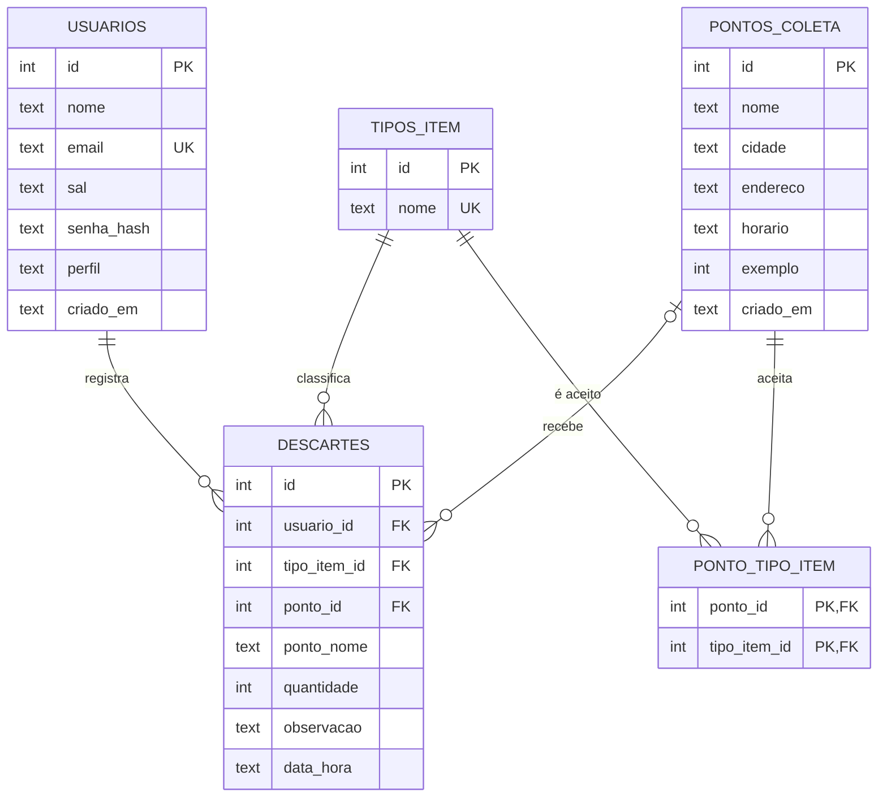

# Banco de dados — EcoColeta Universitária

Modelo de dados relacional (SQLite) que guarda o que hoje a aplicação web salva no `localStorage`: usuários, pontos de coleta, tipos de item e descartes. A aplicação (`index.html` e pasta `js/`) **não foi alterada**; esta pasta é a base de dados que poderá ser ligada a um back-end nas próximas etapas.

## Como executar

Não precisa instalar nada (o módulo `sqlite3` já vem com o Python). Na pasta principal do projeto:

```
python banco-de-dados/executar.py
```

O script recria o banco do zero (`banco-de-dados/ecocoleta.db`), roda os arquivos SQL na ordem e mostra o resultado de cada comando. A saída esperada está em `resultado-da-execucao.txt`.

Também dá para rodar os arquivos manualmente, se tiver o cliente `sqlite3`:

```
sqlite3 ecocoleta.db < 01_schema.sql
sqlite3 ecocoleta.db < 02_dados.sql
```

## Arquivos

| Arquivo | Conteúdo |
|---|---|
| `01_schema.sql` | `CREATE TABLE`, chaves primárias e estrangeiras, restrições, índices e uma view |
| `02_dados.sql` | `INSERT` dos dados (todos fictícios) |
| `03_consultas.sql` | 9 consultas `SELECT` (JOIN, GROUP BY, subconsultas, view) |
| `04_atualizacao_remocao.sql` | `INSERT`, `UPDATE` e `DELETE`, mostrando o efeito de cada um |
| `executar.py` | Roda tudo e ainda testa se as restrições rejeitam dados inválidos |
| `diagrama.png` / `diagrama.dot` | Diagrama das tabelas |
| `resultado-da-execucao.txt` | Saída do `executar.py` |

## Modelo de dados



## Decisões de modelagem

- **Normalização (até a 3FN):** o tipo de item fica em uma tabela própria (`tipos_item`), em vez de repetir o texto em cada ponto e em cada descarte.
- **Relacionamento N:N:** um ponto aceita vários tipos e um tipo é aceito por vários pontos, então existe a tabela de ligação `ponto_tipo_item`, com chave primária composta.
- **Cópia do nome do ponto em `descartes.ponto_nome`:** é uma repetição proposital, igual à da aplicação. Se o ponto for excluído, `ponto_id` vira vazio (`ON DELETE SET NULL`) e o histórico continua mostrando o nome.
- **Regras de exclusão:** apagar um usuário apaga os descartes dele (`CASCADE`); apagar um ponto apaga os tipos que ele aceita (`CASCADE`); um tipo de item em uso não pode ser apagado (`RESTRICT`).
- **Restrições (`CHECK`, `UNIQUE`, `NOT NULL`):** e-mail único e com formato válido, perfil só `estudante` ou `admin`, quantidade entre 1 e 99.
- **Senha:** só `sal` e `senha_hash` são guardados, nunca a senha. Os valores de `02_dados.sql` são textos de exemplo.

## Requisitos atendidos

| Requisito | Onde aparece |
|---|---|
| RF01 cadastro e login | tabela `usuarios` |
| RF02 consultar pontos por cidade e tipo | consultas 1 e 2 |
| RF03 registrar descarte | `INSERT` em `descartes` (arquivo 04) |
| RF04 administrar pontos | `INSERT`, `UPDATE` e `DELETE` em `pontos_coleta` (arquivo 04) |
| RF06 histórico | consulta 3 |
| RF07 relatório | view `vw_relatorio_por_tipo` e consultas 4 a 7 |

## Por que SQLite e como migrar

O SQLite é relacional, roda sem servidor e permite testar tudo em qualquer computador, o que combina com o MVP. Para um servidor de verdade, o mesmo modelo serve em PostgreSQL ou MySQL, trocando principalmente:

- `INTEGER PRIMARY KEY AUTOINCREMENT` por `GENERATED ALWAYS AS IDENTITY` (PostgreSQL) ou `AUTO_INCREMENT` (MySQL);
- `GROUP_CONCAT(...)` por `STRING_AGG(...)` (PostgreSQL);
- `strftime('%Y-%m', ...)` por `TO_CHAR(..., 'YYYY-MM')` (PostgreSQL);
- remover o `PRAGMA foreign_keys` (nos outros bancos as chaves estrangeiras já são sempre verificadas).

Essas adaptações não foram testadas neste projeto.
